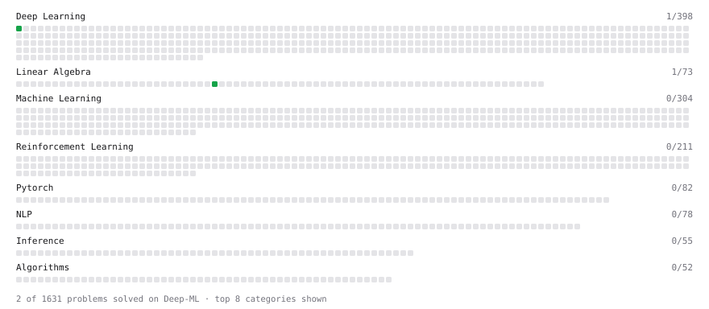

# Deep-ML

My machine learning practice from [Deep-ML](https://www.deep-ml.com). Every solution here was written by hand.

**5** solved · 3 problems · 0 labs · 2 math

[**Browse the interactive portfolio**](https://georgeaaron7.github.io/deep-ml/) to replay this filling in over time.

## Problems

| | Difficulty | Solved | |
| --- | --- | --- | --- |
| [Calculate Mean Absolute Error (MAE)](https://www.deep-ml.com/problems/93) | easy | 2025-06-28 | [solution](problems/0093-calculate-mean-absolute-error-mae) |
| [Dot Product Calculator](https://www.deep-ml.com/problems/83) | easy | 2026-10-23 | [solution](problems/0083-dot-product-calculator) |
| [Sigmoid Activation Function Understanding](https://www.deep-ml.com/problems/22) | easy | 2025-03-26 | [solution](problems/0022-sigmoid-activation-function-understanding) |

## Math

| | Difficulty | Solved | |
| --- | --- | --- | --- |
| [Matrix Basics](https://www.deep-ml.com/math-problems/9) | easy | 2026-10-23 | [solution](math/0009-matrix-basics) |
| [Vector Operations](https://www.deep-ml.com/math-problems/7) | easy | 2026-10-23 | [solution](math/0007-vector-operations) |

---

_This file is regenerated by Deep-ML on every push._
